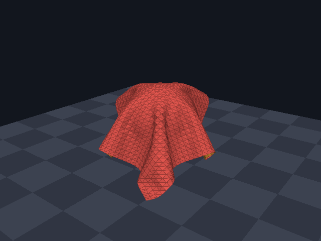
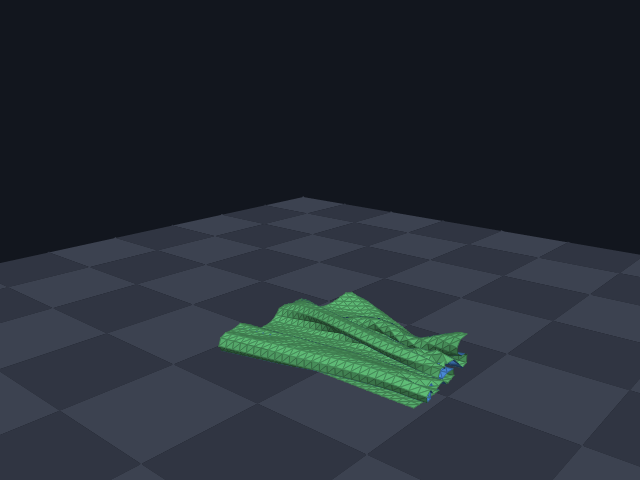
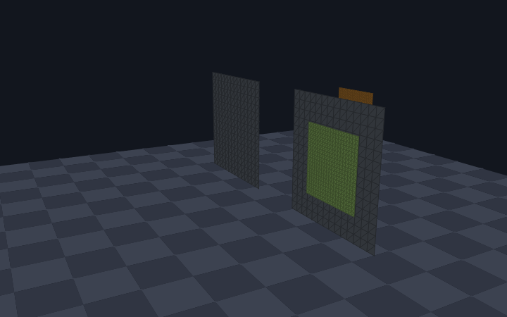
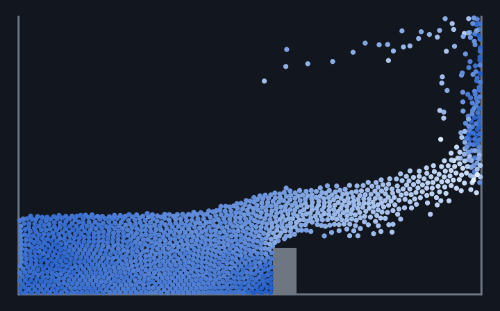
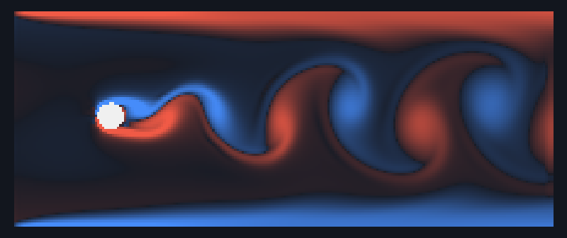
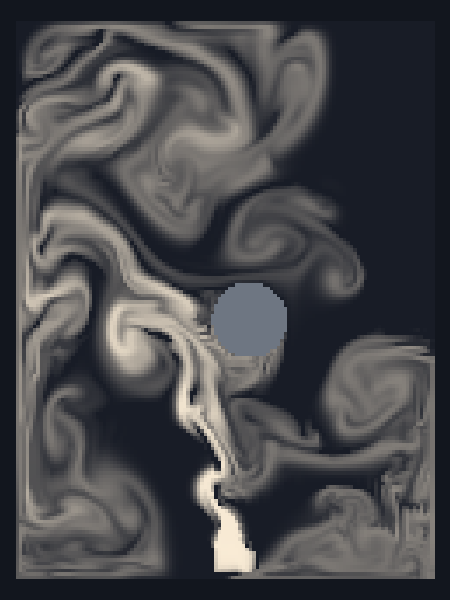

# azlab

**Ein Rust-Workspace für mathematische Grundlagen und darauf aufbauende Fachbibliotheken.**

Das Fundament ist **azmath**: eine generische Mathematik-Bibliothek für Zahlentypen,
lineare Algebra, automatische Differentiation und Gleichungslöser. Ihr Kern
arbeitet mit `no_std` ohne Heap-Allokationen und eignet sich damit auch für
Embedded-Anwendungen.

Darauf baut **azphysics** auf: Kollisionsgeometrie, Gewebe ohne
Durchdringung und Strömung. Seine Beispiele zeigen die Simulationen in einem
Fenster; die Anzeige liefert das kleine Hilfs-Crate **azviz**.

| Crate | Inhalt |
|-------|--------|
| [`azmath`](crates/azmath) | Mathematik: Zahlentypen, lineare Algebra, Autodiff, Löser. Keine Einheiten, Stoffkonstanten oder Fachmodelle |
| [`azphysics`](crates/azphysics) | Physik auf azmath: Geometrie, kontinuierliche Kollisionserkennung, Gewebe, Strömung – siehe [unten](#azphysics) |
| [`azviz`](crates/azviz) | Anzeige für die Beispiele: Fenster, PNG und GIF |

> **Entwicklungsstand:** Alle geplanten Bereiche von azmath sind umgesetzt
> und getestet; azphysics ist in einer ersten Fassung vorhanden. Die API
> kann sich noch ändern; eine Veröffentlichung auf crates.io ist aktuell
> nicht vorgesehen (`publish = false`).

## Grundsätze

- **`no_std` zuerst:** Der Kern benötigt weder Betriebssystem noch Heap.
- **Generische Algorithmen:** Skalar-Traits beschreiben die benötigten
  Rechenfähigkeiten. Neben `f32` und `f64` können passende Algorithmen auch mit
  komplexen Zahlen oder Dualzahlen arbeiten.
- **Feste Größen und eigene Puffer:** Vektoren und Matrizen verwenden const
  generics; etwa für Polynom-Nullstellen stellt der Aufrufer Ausgabepuffer bereit.
- **Austauschbare Rechen-Backends:** Elementarfunktionen werden über `libm`
  oder `std` bereitgestellt, ohne die öffentliche API des Algorithmus zu ändern.
- **Kein `unsafe`:** Im Workspace durch einen Rust-Lint verboten.
- **Explizite Fehler:** Fallible Löser liefern `Result`; iterative Verfahren
  geben Näherung, Restfehler und Iterationszahl zurück. Bei Nicht-Konvergenz
  bleibt der letzte Stand im Fehlerwert verfügbar.

Die Indexoperatoren von Vektoren und Matrizen folgen der Array-Konvention und
können bei ungültigen Indizes eine Panic auslösen. Für geprüften Zugriff stehen
`get` und `get_mut` bereit.

## Umfang

| Bereich | Modul | Umfang |
|---------|-------|--------|
| Skalar-Traits | `scalar` | `Algebra`, `Ring`, `Field`, `Commutative`, `Conjugate`, `Real`, `Elementary`, `RealElementary` |
| Zahlentypen | `number` | `Complex<T>`, `Dual<T>`, `DualN<T, N>`, `CayleyDickson<A>`, `Octonion`, `Quaternion<T>` mit Rotationen und Slerp |
| Intervalle | `interval` | `Interval<T>` mit Rundung nach außen |
| Lineare Algebra, feste Größe | `linalg` | `Vector<T, N>`, `Matrix<T, R, C>`, Produkte, Normen, Transponieren und Adjungieren |
| Zerlegungen | `linalg` | LU, Cholesky, QR; lineare Systeme, Determinante, Inverse, Ausgleichsrechnung |
| Eigenwerte, Singulärwerte | `linalg` | symmetrisch mit Eigenvektoren, allgemein nur Eigenwerte; Singulärwertzerlegung mit Pseudoinverse |
| Lineare Algebra, Größe zur Laufzeit | `linalg` | `MatrixView`, `MatrixViewMut`, dünnbesetzte `CsrMatrix`, `LinearOperator`; mit `alloc` zusätzlich `DMatrix` |
| Tensoren | `tensor` | `TensorView`, `TensorViewMut`, äußeres Produkt, Kontraktion, verallgemeinertes Produkt; mit `alloc` zusätzlich `DTensor` |
| Lie-Theorie | `lie` | `So2`, `So3`, `Se2`, `Se3` mit `exp`, `log`, Adjungierter und Lie-Klammer |
| Autodiff | `autodiff` | vorwärts über Dualzahlen (Ableitung, Gradient, Jacobi-, Hesse-Matrix), rückwärts über ein Band (`Tape`, `Var`) |
| Nullstellen | `solve` | Bisektion, Sekante, Newton, Newton mit Klammer, Brent |
| Gleichungssysteme | `solve` | Newton für nichtlineare Systeme; konjugierte Gradienten (auch vorkonditioniert), BiCGSTAB und GMRES für große lineare Systeme |
| Polynome | `poly` | Horner- und Tschebyschow-Auswertung, Formeln bis Grad 4, alle komplexen Nullstellen, lückenlose Einschließung reeller Nullstellen |
| Differentialgleichungen | `ode` | Euler, RK4, Dormand-Prince mit Schrittweitensteuerung, implizites Euler-Verfahren, Trapezregel |
| Partielle Differentialgleichungen | `pde` | regelmäßige Gitter, Laplace- und Ableitungsoperator mit Randbedingungen, impliziter Zeitschritt, Mehrgitter für die Poisson-Gleichung |
| Finite Elemente | `fem` | Elementmatrizen für Strecke, Dreieck, Viereck, Tetraeder, ebene Elastizität; matrixfreier Operator; mit `alloc` Assemblierung nach CSR |
| Quadratur | `quad` | Trapez- und Simpsonregel, Gauß-Legendre, adaptive Simpson-Quadratur |
| Interpolation | `interp` | linear, kubische Splines, baryzentrische Polynominterpolation, Tschebyschow-Reihen |
| Optimierung | `optim` | Gradientenabstieg, BFGS, L-BFGS, Nelder-Mead, Levenberg-Marquardt |
| Fourier-Transformation | `fft` | schnelle Transformation für Zweierpotenzen, direkte Summe für jede Länge |
| Spezielle Funktionen | `special` | Gamma-, Beta- und Fehlerfunktion, unvollständige Gammafunktion |

Welche Zahlentypen ein Verfahren unterstützt, bestimmen seine Trait-Grenzen.
Nicht jede Kombination aus Algorithmus und Zahlentyp ist sinnvoll oder verfügbar.

## Einbinden

Vorausgesetzt wird stable Rust. Das Workspace-Manifest deklariert Rust
`1.86` als Mindestversion und verwendet die Edition `2024`.

Da das Projekt noch nicht auf crates.io veröffentlicht wird, kann azmath als
Git-Abhängigkeit eingebunden werden:

```toml
[dependencies]
azmath = { git = "https://github.com/Andie2302/azlab.git", branch = "master" }
```

Für reproduzierbare Abhängigkeiten kann statt `branch` ein konkreter Commit
über `rev` festgelegt werden.

Bei einem lokalen Checkout ist alternativ eine Pfad-Abhängigkeit möglich.
Den Pfad an die eigene Verzeichnisstruktur anpassen:

```toml
[dependencies]
azmath = { path = "../azlab/crates/azmath" }
```

### Features und Backends

| Konfiguration | Wirkung |
|---------------|---------|
| Standard: `libm` | `no_std` ohne Heap; Elementarfunktionen über die optionale Abhängigkeit `libm` |
| `default-features = false` | Keine Abhängigkeiten; keine Implementierungen von `Elementary` und `RealElementary` für `f32`/`f64` |
| `std` | Elementarfunktionen über `std`; aktiviert zusätzlich `alloc` |
| `alloc` | Zusätzliche Typen mit eigenem Speicher: `DMatrix`, `DTensor`, `GrowTape`, `assemble_csr`. Alles andere bleibt ohne Heap nutzbar |

Sind `std` und `libm` gleichzeitig aktiv, verwendet azmath das
`std`-Backend. Die Features bleiben additiv.

Ohne Rechen-Backend:

```toml
[dependencies]
azmath = { git = "https://github.com/Andie2302/azlab.git", default-features = false }
```

Mit `std`-Backend:

```toml
[dependencies]
azmath = { git = "https://github.com/Andie2302/azlab.git", default-features = false, features = ["std"] }
```

## Tuchdiagnose

```bash
cargo demo cloth_diagnostics
```

Das Fenster startet pausiert und zeigt das Tuch zusammen mit Verlaufskurven
für Energie, linearen Impuls, Drehimpuls um den Schwerpunkt sowie maximale
und mittlere quadratische relative Constraint-Abweichung (RMS).
Zusätzlich erscheinen absolute Constraint-Verletzung, CCD-Ereignisse,
Rücksetzungen und die CPU-Zeit des letzten Physikschritts.

| Taste | Aktion |
|-------|--------|
| **1** | Gleichförmiger freier Flug |
| **2** | Freie Rotation, ohne Schwerkraft und Dämpfung |
| **3** | Hängendes Tuch mit Haltepunkten und Dämpfung |
| **4** | Fall auf eine Kugel mit Boden und Reibung |
| **Leertaste** / **N** | Weiter/Pause / genau ein Physikschritt |
| **S** | Sichtbare Messhistorie nach `cloth_diagnostics.csv` schreiben (überschreibt die Datei) |
| **Pfeile** / **Bild auf/ab** | Kamera drehen / zoomen |

Die Tasten **1–4** setzen den Versuch einschließlich Zeit und Referenzwerten
zurück. Das Fenster hält die letzten 1200 Stichproben; die angezeigten
Änderungen ΔE, Δp und ΔL beziehen sich weiterhin auf den Versuchsbeginn.
Die CSV ist eine Messdatei, kein ladbarer Simulationszustand; **L** wird hier
nicht unterstützt.

Ohne Fenster lässt sich ein vollständiger Lauf als eigenständiger,
interaktiver HTML-Bericht mit zugehöriger CSV-Datei speichern:

```bash
cargo demo cloth_diagnostics -- --report rotation.html --scenario rotation --frames 600
cargo demo cloth_diagnostics -- --report hanging.html --scenario hanging --frames 600
cargo demo cloth_diagnostics -- --report rotation_16.html --scenario rotation --substeps 16 --frames 600
cargo demo cloth_diagnostics -- --help
```

Den Bericht direkt im Browser öffnen: Er benötigt keinen Server und keine
Internetverbindung. Zeitspanne und sichtbare Kurven lassen sich auswählen;
der Zeiger zeigt die Messwerte an. HTML und CSV enthalten auch den
Anfangszustand `t=0`. Vorhandene Berichtsdateien werden nicht überschrieben.
Weitere Berichtsoptionen sind `--dt SEKUNDEN` (Standard 1/60),
`--iterations N`, `--damping WERT`, `--no-self-collision` und `--no-ccd`.
Die Szenarien heißen `flight`, `rotation` (Standard), `hanging` und `sphere`.
Alle Versuche rechnen mit `f32` wie die üblichen Tuchbeispiele.

**Messwerte richtig einordnen:** Impuls und Teilchenenergie erfassen nur
bewegliche Massen, keine Haltepunkte oder Hindernisse. Die mechanische
Energie umfasst kinetische, Gravitations- und Federenergie nachgiebiger
Verbindungen (`C²/(2 compliance)`), jedoch keine Kontaktenergie. Harte oder
abgeschaltete Bedingungen tragen keine Federenergie bei. Schwerkraft,
Haltepunkte und Kontakte können Impuls ändern; Dämpfung, Reibung und
unelastische Kollisionen dürfen Energie abbauen. Abweichungen sind deshalb
keine automatische Fehlerbewertung. Gemessen wird aus den öffentlich
sichtbaren, gerundeten Positionen, ohne interne Rundungsreste.
Relative Abweichungen erfassen Dehn- und Scherverbindungen; der absolute
Constraint-Fehler berücksichtigt außerdem Biegeverbindungen.
NaN/Unendlich stoppt die Messung und wird im Bericht gekennzeichnet.

Die allokationsfreie Momentaufnahme steht auch direkt als
`Cloth::diagnostics()` zur Verfügung. Die Anzeige und Berichte benötigen
`std`; die Messfunktion selbst bleibt mit `no_std` und `alloc` verwendbar.

## Beispiele

Die folgenden Beispiele zeigen die Verwendung in einer normalen Rust-Anwendung.
`println!` gehört zur Anwendung; der mathematische Kern benötigt dafür kein
`std`. Die Beispiele werden bei jedem Testlauf mit übersetzt und ausgeführt.

### Ein lineares Gleichungssystem lösen

Die Matrix und die rechte Seite werden mit fester Größe angelegt.
Fehler wie eine singuläre Matrix werden über `Result` weitergegeben.

```rust
use azmath::{LinalgError, Matrix, Vector};

fn main() -> Result<(), LinalgError> {
    let a = Matrix::new([[2.0_f64, 1.0], [1.0, 3.0]]);
    let b = Vector::new([3.0_f64, 5.0]);

    let x = a.solve(b)?;
    println!("Lösung: {x:?}");
    Ok(())
}
```

Für mehrere rechte Seiten kann die Matrix einmal mit `a.lu()?` zerlegt und
die Zerlegung anschließend über `Lu::solve` wiederverwendet werden.

### Eine generische Funktion automatisch ableiten

Die Funktion wird über einen Skalar-Trait formuliert. Dadurch lässt sie sich
sowohl mit einem Gleitkommatyp als auch mit Dualzahlen aufrufen.

```rust
use azmath::autodiff::derivative;
use azmath::scalar::Elementary;

fn model<T: Elementary>(x: T) -> T {
    x.sin() * x.exp()
}

fn main() {
    let (value, slope) = derivative(model, 1.0_f64);
    println!("Funktionswert: {value}, Ableitung: {slope}");
}
```

Dieses Beispiel benötigt ein Backend für die Elementarfunktionen, etwa das
standardmäßig aktivierte `libm`. Für mehrere Veränderliche stehen
`gradient`, `jacobian` und `hessian` zur Verfügung.

### Eine Nullstelle mit Brent suchen

Brent nutzt ein Intervall mit Vorzeichenwechsel. Abbruchkriterien werden über
`Tolerance` vorgegeben; das Ergebnis enthält auch Restfehler und Iterationszahl.

```rust
use azmath::solve::brent;
use azmath::{SolveError, Tolerance};

fn main() -> Result<(), SolveError<f64, f64>> {
    let tolerance = Tolerance::<f64>::default();
    let solution = brent(
        |x: f64| x * x - 2.0,
        1.0,
        2.0,
        &tolerance,
    )?;

    println!(
        "Näherung: {}, Restfehler: {}, Iterationen: {}",
        solution.x, solution.residual, solution.iterations,
    );
    Ok(())
}
```

Brent und die übrigen skalaren Nullstellenverfahren benötigen selbst kein
Rechen-Backend. Eine übergebene Funktion kann je nach verwendeten Operationen
dennoch eines benötigen.

### Ein Anfangswertproblem lösen

Das Dormand-Prince-Verfahren wählt seine Schrittweite selbst. Die Zahl der
Gleichungen steht im Typ; hier die Schwingung `y'' = −y` als System.

```rust
use azmath::Vector;
use azmath::ode::{OdeError, OdeOptions, dormand_prince};

fn main() -> Result<(), OdeError<f64, 2>> {
    let start = Vector::new([1.0_f64, 0.0]);
    let end = dormand_prince(
        |_t, y: Vector<f64, 2>| Vector::new([y[1], -y[0]]),
        0.0,
        start,
        core::f64::consts::PI,
        &OdeOptions::default(),
    )?;

    // Nach einer halben Periode: (−1, 0).
    println!("y = {:?} nach {} Schritten", end.y, end.steps);
    Ok(())
}
```

### Eine Funktion minimieren

BFGS braucht Funktionswert und Gradient. Der Gradient entsteht automatisch,
wenn die Funktion generisch geschrieben ist.

```rust
use azmath::autodiff::gradient;
use azmath::optim::bfgs;
use azmath::scalar::Field;
use azmath::{SolveError, Tolerance, Vector};

fn rosenbrock<T: Field>(p: Vector<T, 2>) -> T {
    let (a, b) = (T::ONE - p[0], p[1] - p[0] * p[0]);
    a * a + T::from_f64(100.0) * b * b
}

fn main() -> Result<(), SolveError<Vector<f64, 2>, f64>> {
    let tolerance = Tolerance::<f64>::default().with_max_iterations(1000);
    let minimum = bfgs(
        |x| gradient(rosenbrock, x),
        Vector::new([-1.2, 1.0]),
        &tolerance,
    )?;

    // Das Minimum liegt bei (1, 1).
    println!("Minimum bei {:?}", minimum.x);
    Ok(())
}
```

## azphysics

Physik-Simulationen auf der Grundlage von azmath. Geometrie und
Kollisionserkennung laufen wie azmath in `no_std` ohne Heap; die
Simulationen verwalten viele Teilchen und stehen deshalb hinter dem Feature
`alloc`.

| Modul | Inhalt | Braucht |
|-------|--------|---------|
| `geometry` | nächste Punkte und Abstände zwischen Punkt, Strecke und Dreieck; Schnitt-Tests; Hüllquader | – |
| `ccd` | kontinuierliche Kollisionserkennung: Wann berühren sich bewegte Punkte, Kanten und Dreiecke? | – |
| `broadphase` | Raumgitter für die Grobphase | `alloc` |
| `cloth` | Gewebe mit XPBD, Hindernissen, Selbstkollision und Sicherung gegen Durchdringung | `alloc` |
| `fluid` | Navier-Stokes auf dem Gitter (Rauch, Umströmung) und Flüssigkeit aus Teilchen | `alloc` |

### Gewebe ohne Durchdringung

Das Tuch besteht aus Teilchen mit Abstandsbedingungen (XPBD). Gegen
Durchdringung wirken zwei Stufen:

1. **Abstoßung:** Kommt ein Teilchen einem Dreieck näher als die Dicke des
   Tuchs, werden beide auseinandergeschoben.
2. **Sicherung:** Am Ende jedes Teilschritts prüft die kontinuierliche
   Kollisionserkennung die ganze Bewegung jedes Paars aus Punkt und Dreieck
   und aus zwei Kanten. Sie verfolgt den Abstand der beiden Teile über den
   Teilschritt und rückt dabei jeweils nur so weit vor, wie sich die Teile
   in der Zeit höchstens nähern können; so entgeht ihr keine Berührung.
   Kämen sich Teile näher als die Toleranz, wird ihre Bewegung gekürzt;
   notfalls kehren alle Teilchen an den Anfang des Teilschritts zurück.

Damit gilt: War das Netz vor dem Schritt frei von Durchdringungen, ist es
das danach auch – gleich wie schnell es sich bewegt und wie dünn es ist. Die
Zusage gilt für Dreiecke (das Tuch selbst und Hindernisse aus Dreiecken) und
für geradlinige Bewegung innerhalb eines Teilschritts; `Cloth::intersections`
zählt zur Kontrolle nach.

### Beispiele

Jedes Beispiel öffnet ein Fenster (Leertaste hält an, Esc beendet):

```bash
cargo demo cloth_drape
```

`cargo demo` ist ein Kurzbefehl aus [.cargo/config.toml](.cargo/config.toml)
für `cargo run --release -p azphysics --features std --example`. Ohne
Bildschirm lässt sich jedes Beispiel in eine Datei schreiben:

```bash
cargo demo fluid_smoke -- --gif rauch.gif --frames 300 --size 300x400
```

```bash
cargo demo cloth_drape -- --png tuch.png --frames 200
```

| Beispiel | Zeigt |
|----------|-------|
| `cloth_drape` | Ein Tuch fällt auf eine Kugel und legt sich in Falten darüber |
| `cloth_fold` | Ein hochkant fallendes Tuch faltet sich auf dem Boden auf sich selbst – ohne Durchdringung |
| `cloth_tunnelling` | Zwei Tücher mit 60 m/s gegen eine dünne Platte: ohne Sicherung fliegt das Tuch hindurch, mit Sicherung bleibt es hängen |
| `fluid_smoke` | Rauch steigt in einem geschlossenen Kasten auf und umströmt ein Hindernis |
| `fluid_vortex_street` | Kármánsche Wirbelstraße hinter einem angeströmten Zylinder |
| `fluid_dam_break` | Dammbruch: Eine Wassersäule aus Teilchen stürzt in ein Becken |
| `cloth_free_flight` | Kontrollversuch: gleichförmiger freier Flug, Orts-/Geschwindigkeitsfehler, S/L-Zustandsdateien |
| `fluid_rest_lab` | Sechs Kontrollbecken mit getrennten Randmessungen und S/L-Zustandsdateien |

| | |
|---|---|
|  `cloth_drape` |  `cloth_fold` |
|  `cloth_tunnelling`: hinten ohne, vorn mit Sicherung |  `fluid_dam_break` |
|  `fluid_vortex_street` |  `fluid_smoke` |

### Einbinden

```toml
[dependencies]
azphysics = { git = "https://github.com/Andie2302/azlab.git", branch = "master", features = ["alloc"] }
```

Die Features `libm` (Standard), `std` und `alloc` werden an azmath
durchgereicht; `std` schaltet `alloc` mit ein.

Dieses Beispiel steht auch in der Dokumentation von azphysics und wird dort
als Test ausgeführt:

```rust,ignore
use azmath::Vector;
use azphysics::cloth::{Cloth, Collider};

// Tuch aus 12 × 12 Teilchen, 1 m × 1 m, in 30 cm Höhe.
let spacing = 1.0 / 11.0;
let mut cloth: Cloth<f64> = Cloth::grid(
    12,
    12,
    Vector([-0.5, 0.3, -0.5]),
    Vector([spacing, 0.0, 0.0]),
    Vector([0.0, 0.0, spacing]),
    0.01,
);
let ground = [Collider::Plane { point: Vector([0.0; 3]), normal: Vector([0.0, 1.0, 0.0]) }];

for _ in 0..40 {
    cloth.step(1.0 / 60.0, &ground);
}
// Das Tuch liegt auf dem Boden: knapp darüber, nirgends darunter.
assert!(cloth.positions().iter().all(|point| point[1] > 0.0 && point[1] < 0.05));
assert_eq!(cloth.intersections(), 0);
```

## Aufbau des Repositorys

| Pfad | Inhalt |
|------|--------|
| [crates/azmath](crates/azmath) | Mathematische Kernbibliothek |
| [crates/azphysics](crates/azphysics) | Physik-Simulationen; Beispiele unter `examples/` |
| [crates/azviz](crates/azviz) | Anzeige für die Beispiele |
| [docs/bilder](docs/bilder) | Bilder der Beispiele |
| [todo](todo/README.md) | Ziele, Architektur, Entscheidungen und Detailpläne |
| [scripts/pruefen.sh](scripts/pruefen.sh) | Prüfmatrix |
| [pruefung/ergebnis.txt](pruefung/ergebnis.txt) | Eingechecktes Prüfprotokoll |
| [MOEGLICHE_PROBLEME.md](MOEGLICHE_PROBLEME.md) | Gemeldete Probleme und ihr Stand |

## Dokumentation und lokale Prüfung

Die API-Dokumentation lässt sich lokal erzeugen:

```bash
cargo doc --workspace --no-deps --all-features --open
```

Die vollständige Prüfmatrix läuft mit:

```bash
scripts/pruefen.sh
```

Das Skript prüft für azmath und azphysics Tests und Clippy in den
Kombinationen ohne Features, mit `libm`, mit `std`, mit `alloc` und mit allen
Features, dazu azviz. Zusätzlich erzeugt es die API-Dokumentation und baut,
sofern das Target installiert ist, beide Bibliotheken für
`thumbv7em-none-eabihf` mit und ohne Standard-Features.

Ist die im Manifest genannte Mindestversion von Rust installiert
(`rustup toolchain install 1.86 --profile minimal`), übersetzt das Skript
beide Bibliotheken auch mit ihr.

Das Embedded-Target kann zuvor installiert werden:

```bash
rustup target add thumbv7em-none-eabihf
```

Das Ergebnis wird nach `pruefung/ergebnis.txt` geschrieben.

## Grenzen und möglicher Ausbau

Bewusst nicht enthalten oder noch offen:

- `f16` und `f128`: erst, wenn sie in stable Rust verfügbar sind.
- Eigenvektoren allgemeiner (nicht symmetrischer) Matrizen.
- Bessel-Funktionen und weitere spezielle Funktionen.
- Finite Elemente höherer Ordnung, Elastizität in 3D, Netzerzeugung.
- Fertige Vorkonditionierer für die iterativen Löser (das vorkonditionierte
  Verfahren selbst ist vorhanden).
- Elementarfunktionen auf Intervallen.

In azphysics:

- Die Sicherung gegen Durchdringung gilt für Dreiecke. Die einfachen
  Hindernisse Ebene und Kugel schieben Teilchen nur hinaus; eine sehr
  schnelle Bewegung kann eine kleine Kugel überspringen.
- Teile, die sich näher als die Toleranz der Sicherung gekommen sind,
  bleiben aneinander stehen, bis die Abstoßung sie trennt.
- Strömung nur in der Ebene; die Teilchenflüssigkeit kennt keine
  Oberflächenspannung.

Weitere Fach-Crates sollen auf azmath aufbauen, etwa Stoffdatenmodelle. Sie
sind kein Bestandteil von azmath.

Details stehen in der [Roadmap](todo/04-roadmap.md), die Abgrenzung in den
[Zielen und Nicht-Zielen](todo/01-ziele.md).

## Entwicklung

Entwurfsgrundsätze, Entscheidungen und Pläne stehen in [todo](todo/README.md).
Dokumentation und Commit-Nachrichten sind deutsch, Bezeichner englisch. Jeder
Stand auf `master` besteht `scripts/pruefen.sh`.

## Lizenz

Im Workspace-Manifest ist `MIT OR Apache-2.0` als Lizenz angegeben.


### Simulationen untersuchen

`cargo demo cloth_drape -- --paused --profile` startet vor dem ersten
Simulationsschritt pausiert. Leertaste schaltet die Pause um; **N** führt
genau einen festen Zeitschritt aus und bleibt danach pausiert. In den drei
Gewebe-Beispielen drehen die Pfeiltasten die Kamera, Bild auf/ab zoomt und
**G** blendet den Boden aus oder ein. Kamerabewegungen ändern die Physik
nicht. PNG/GIF ignorieren den Pausenschalter und rechnen wie bisher die
angeforderte Bildzahl.

`--profile` protokolliert im Fenster alle 120 Bilder die mittlere CPU-Zeit
je Physikschritt und je Zeichenaufbau. GPU-Ausführung, Präsentation und
Wartezeit sind darin nicht enthalten. Vergleiche im Release-Profil bei
gleicher Fenstergröße und gleichem Simulationszustand durchführen.

Längere Teilchen-Kontrollversuche sind separat aufrufbar:

```bash
cargo test -p azphysics --features std --release small_full_pool_defaults -- --ignored --nocapture
cargo test -p azphysics --features std --release particle_resolution_and_obstacle_sweep -- --ignored --nocapture
```

Der Hindernisvergleich misst unterschiedliche Dicken und Auflösungen, ohne
dünnen Wänden bereits dieselbe Ruhegarantie wie dicken Wänden zuzuschreiben.
CG und vorkonditioniertes CG melden bei nicht endlichen Zwischenwerten
`SolveError::NonFinite` statt Erfolg. Systeme mit extremen Größenordnungen
benötigen gegebenenfalls eine vorherige Skalierung.


### Detaillierte Gewebe-Messung

Mit `--profile` liefern `cloth_drape`, `cloth_fold` und
`cloth_tunnelling` zusätzlich CPU-Zeiten für freie Bewegung, XPBD,
Hindernisse, Nachbarschaftssuche, Abstoßung, CCD und Geschwindigkeiten.
Die Nachbarschaftszeit umfasst auch die Gültigkeitsprüfung der Listen;
Abstoßung und CCD enthalten diese Suche nicht nochmals.
CCD-Treffer und vollständige Rücksetzungen werden je Messfenster gezählt.
Beim Tunnelbeispiel zählen beide Tücher als eigene Tuchschritte.
Die Messaufrufe verursachen selbst etwas Aufwand; ohne `--profile` laufen
keine Abschnittsuhren. `azphysics` bleibt dabei ohne `std` nutzbar:
`Cloth::step_observed` meldet nur abgeschlossene Abschnitte an einen Callback.

Farb- und Tiefenspeicher werden zwischen Bildern wiederverwendet und vor
jedem Batch gelöscht. Das Fenster aktualisiert vorhandene Texturen;
Größenänderungen erzeugen neue Texturen. PNG/GIF verwenden ebenfalls den
wiederverwendbaren CPU-Speicher. Die Tiefenprüfung und Simulationsparameter
bleiben unverändert. Eine Beschleunigung muss auf dem Zielrechner mit
gleicher Szene und Fenstergröße gemessen werden.


### Kontrollbeispiele und Zustandsdateien

```bash
cargo demo cloth_free_flight -- --paused
cargo demo fluid_rest_lab -- --paused
```

**Freier Flug:** Ein Tuch fliegt ohne Schwerkraft, Dämpfung oder Hindernisse,
mit Selbstkollision und CCD. Die Kameraansicht bewegt sich rechnerisch mit
der erwarteten Translation; dadurch bleibt das Tuch im Bild. Angezeigt
werden der größte Orts- und Geschwindigkeitsfehler gegenüber gleichförmiger
Translation sowie die Dehnung. Grün bedeutet lediglich, dass die angezeigten
Diagnoseschwellen eingehalten werden, keine allgemeine Genauigkeitsgarantie.

**Ruhebecken:** Die Tasten **1–6** starten feste Versuchsvarianten neu und
pausieren: kleines volles Becken, flaches grobes Becken, flaches feines
Becken, dünnes Hindernis, dickes Hindernis und volles Becken ohne Schwerkraft.
Die Standardparameter werden bis auf die ausdrücklich ausgeschaltete
Schwerkraft der letzten Variante beibehalten. Für linke Wand, Mitte und
rechte Wand werden Besetzung, mittlere und maximale Geschwindigkeit gezeigt.
Die Dichteanzeige ist unmittelbar nach dem Laden noch nicht neu berechnet.
Ein höheres anfängliches Tempo kann das Einschwingen zeigen; für Ruhe müssen
die Messwerte über die Zeit betrachtet werden.

In diesen beiden Beispielen speichert **S** den Zustand im aktuellen
Arbeitsverzeichnis (`cloth_free_flight.azstate` beziehungsweise
`fluid_rest_lab.azstate`). **L** lädt die Datei und pausiert; **N** rechnet
anschließend einen Schritt. Eine vorhandene Datei gleichen Namens wird
überschrieben. Andere Beispiele unterstützen Zustandsdateien vorerst nicht.

Das versionierte Textformat speichert Versuchsvariante, Schrittzähler,
simulierte Zeit sowie Positionen und Geschwindigkeiten als exakte
Gleitkomma-Bitmuster. Beim Laden werden Variante, Punktzahl und endliche
Werte geprüft; fehlerhafte Daten ersetzen den laufenden Zustand nicht.
Geometrie, Massen und Parameter werden aus der festen Variante aufgebaut:
Dateien sind nur für dieselbe Beispielversion bestimmt, keine universellen
oder über Codeänderungen hinweg garantierten Checkpoints.
Kamera und temporäre Suchlisten werden nicht gespeichert. Das Laden dient
der geometrischen Diagnose und Fortsetzung; bitidentische Fortsetzung bei
allen Szenen oder Plattformen wird nicht zugesagt.

Die Physik-APIs `Cloth::restore_motion` und
`ParticleFluid::restore_motion` verwenden vorhandene Topologie und Parameter
und sind unabhängig von Datei-I/O auch mit `alloc` ohne `std` nutzbar.
Tests für die Beispiele (einschließlich Dateiformat) lassen sich so starten:

```bash
cargo test -p azphysics --features std --release --examples
```


### Drift im freien Flug eingrenzen

Die folgenden Beispiele vergleichen sich mit `cloth_free_flight_no_self_collision`.
CCD und Selbstkollision sind in allen drei Versuchen ausgeschaltet.

| Beispiel | Physik | Stoffkorrekturen |
| --- | --- | --- |
| `cloth_free_flight_no_self_collision` | f32 | an |
| `cloth_free_flight_f64` | f64 | an |
| `cloth_free_flight_unconstrained` | f32 | aus (`iterations = 0`) |

```bash
cargo demo cloth_free_flight_f64 -- --paused
cargo demo cloth_free_flight_unconstrained -- --paused
```

**N** rechnet einen Schritt. Orts-/Geschwindigkeitsfehler, vorzeichenbehaftete
mittlere Geschwindigkeitsabweichung, Beschleunigung und Ruck bleiben sichtbar.
Die f64-Variante zeigt kleine Fehler in wissenschaftlicher Schreibweise;
nur die Darstellung wird in f32 umgewandelt. Der vom Runner vorgegebene
Zeitschritt bleibt derselbe. Ihre Startgeschwindigkeiten, Gitterabstände,
Masse und Nachgiebigkeit übernehmen die repräsentierten f32-Parameter.
Gitterpositionen und Ruhelängen entstehen anschließend mit f64-Rechnung.

Die freien Teilchen durchlaufen weiterhin die normale Substep-Integration
und Geschwindigkeitsrekonstruktion von `Cloth::step`. Die Dreiecke dienen
hier der Darstellung; sie erzwingen keine Verbindung mehr. Dehnung ist
deshalb eine Messgröße, keine durchgesetzte Bedingung.
`ClothParams::iterations = 0` bedeutet jetzt ausdrücklich null
Stoffkorrekturen; positive Werte und Standardparameter bleiben unverändert.

Die f32-Variante unterstützt **S/L** mit einer eigenen Zustandsdatei.
Die f64-Variante unterstützt vorerst keine Zustandsdateien, damit das
bisherige f32-Dateiformat keine Genauigkeit verliert.

```bash
cargo test -p azphysics --features std --release --example cloth_free_flight_f64 -- --nocapture
cargo test -p azphysics --features std --release --example cloth_free_flight_unconstrained -- --nocapture
cargo test -p azphysics --features std --release zero_iterations_free_path
```

Der f64-Bewegungstest läuft 1200 Schritte, über den beobachteten ersten
Schwellwertübertritt bei Schritt 1044 hinaus. Der freie f32-Langlauf
protokolliert die Fehler bei Schritt 1043, 1044 und 1200 und prüft endliche
Werte; er behauptet nicht, dass die untersuchte Drift bereits behoben sei.
Separate Physiktests prüfen bei f32 und f64 an einem absichtlich gedehnten
Netz mit einem fixierten Teilchen, dass null Iterationen tatsächlich dem
Rechenweg freier Teilchen entsprechen.
